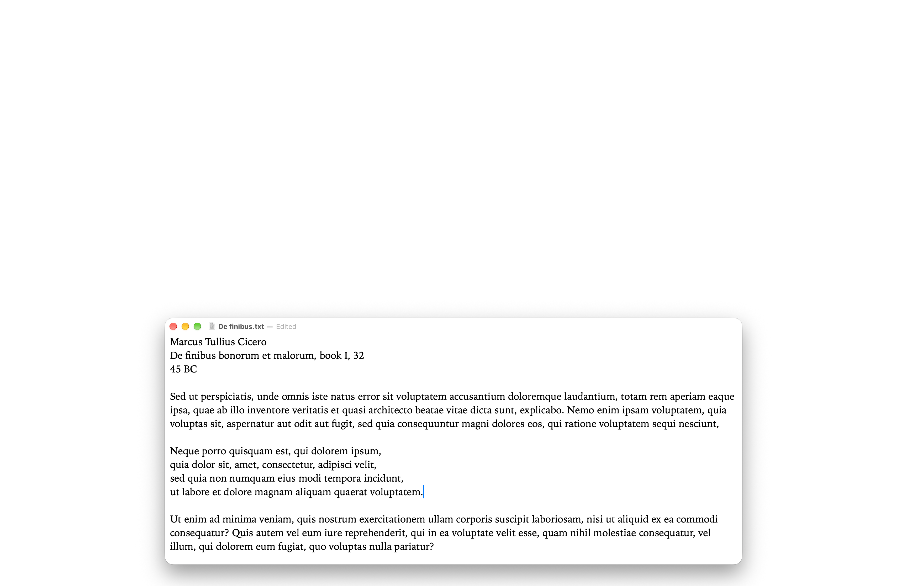

<picture><source media="(prefers-color-scheme: dark)" srcset="docs/icon-github-dark.png"></picture>

# Copia

Clipboard manager for Mac. Keeps every copy and pastes several at once or one by one.

<picture><source media="(prefers-color-scheme: dark)" srcset="docs/scene.webp"></picture>

<picture><source media="(prefers-color-scheme: dark)" srcset="docs/scene-after.webp"></picture>

Apple silicon, macOS 13 or later.

## Install

```sh
brew install geragarazagh/tap/copia
```

Or download [`Copia.dmg`](https://github.com/geragarazagh/copia/releases/latest/download/Copia.dmg).
