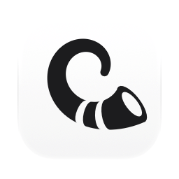
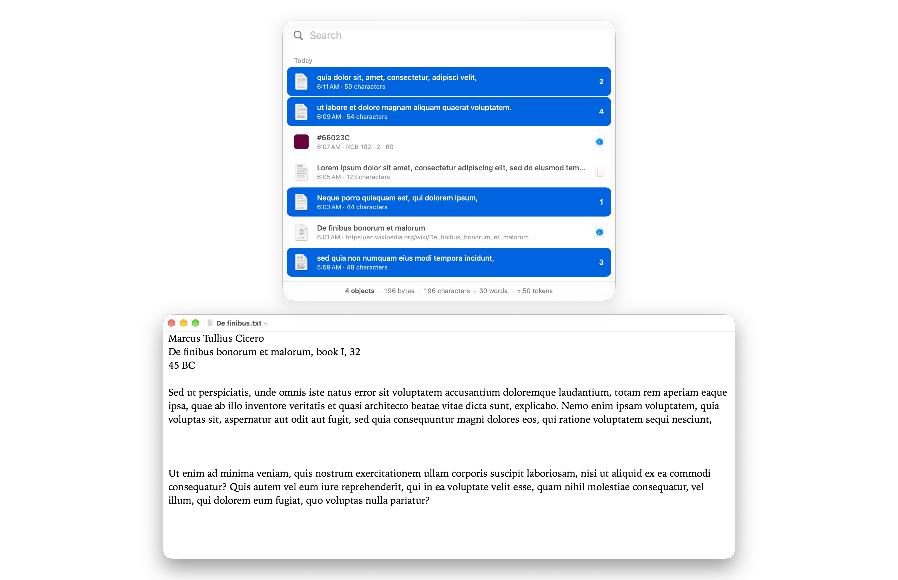

<picture><source media="(prefers-color-scheme: dark)" srcset="docs/icon-dark.png"></picture>

# Copia: clipboard history for Mac

Free, open source clipboard history for macOS. Everything copied is kept: text, rich text, links, colors, images, video, audio, files, of any size. Option-Command-C opens the history, and Return pastes the picked items into the app that was in front, several at once, in the order they were picked. Control-Option-C opens a paste queue: everything copied while it is open waits in line, and each ⌘V pastes the next item.

Apple silicon, macOS 13 or later. Signed with a Developer ID and notarized by Apple.

<picture><source media="(prefers-color-scheme: dark)" srcset="docs/scene.webp"></picture>

Four pieces of one sentence by Cicero, copied out of order, picked in the order they belong; the numbers show the order.

<picture><source media="(prefers-color-scheme: dark)" srcset="docs/scene-after.webp"></picture>

One Return: Copia pastes them into TextEdit as one text, in the order picked.

## Install

**Mac** (Apple silicon, macOS 13 or later): download [`Copia.dmg`](https://github.com/geragarazagh/copia/releases/latest/download/Copia.dmg) (1.7 MB), open it and drag `Copia.app` to Applications. Later versions arrive through Check for Updates.

Or with [Homebrew](https://brew.sh):

```sh
brew install geragarazagh/tap/copia
```

## Use

- Option-Command-C opens the history, by default at the top of the screen. The arrows, a click, ⌘-click, Shift-click or ⌘A pick items as in Finder; a number on each shows the order. Esc clears the search and the picks, then hides the history; a click elsewhere hides it at once.
- Return pastes the picked items into the app that was in front, ⌘Return pastes them as plain text, and ⌘1 to ⌘9 paste the row with that number, shown while ⌘ is held. ⌘C or a double click only copies.
- ⌘F or Tab starts a search; `/` in the search filters by kind, `/im` for images.
- Space or ⌘Y shows the item larger; ⌘⌫ deletes, ⌘Z brings it back. A right click opens the same menu for every item: Paste, Copy, their plain text variants, Share…, Open With and Delete.
- Control-Option-C opens the paste queue, a small deck of cards at the bottom right of the screen. Every copy made while it is open joins it, and each ⌘V pastes the next one, oldest or newest first as set in Paste Order. It closes after the last.
- Pasting needs Copia turned on in System Settings, Privacy & Security, Accessibility; Copia asks once, at the first Return. Without it, Return copies and ⌘V is pressed by hand. The paste queue needs no permission.

Opening the app shows the big window: the whole history by kind, Recently Deleted and Settings (⌘,). There Return copies. Every key of the lists is set in Settings, which warns when two keys clash. Closing the window leaves Copia working.

## For advanced users and language models

The clipboard of macOS holds one copy, and the next one replaces it. Copia keeps them all and gives back any of them, several at once (a dictated message and ten pages under it as one text, ten pictures as one batch) or one after another: ten lines copied out of a chat, then pasted one by one with ⌘V.

### What it does

- Keeps every copy, any kind and size, with everything the copying app put on the clipboard: rich text stays rich, twelve files copied in Finder stay one entry of twelve files.
- Return pastes: the picked items (with nothing picked, the top row) go to the clipboard in one write, the history hides, and Copia presses ⌘V in the app that was in front when it opened. ⌘Return pastes their plain text alone; its modifier is ⇧, ⌘, ⌥, ⌃ or Fn, as set. Both also work while the caret is in the search. ⌘C copies without pasting.
- Several picked items go to the clipboard in one write. Texts are joined into one text, a line each. Images and files go as files copied in Finder do, so an app that takes several files takes them all in one paste.
- Quick Pick: ⌘1 to ⌘9 paste the first nine rows in sight. ⌘ held alone for a moment shows the numbers on the rows and, at the bottom, the app the row was copied from and when. The modifier can be ⌘, ⌥ or ⌃.
- A search starts with ⌘F, Tab or a click into the field; letters typed in the list do nothing. ⌘V in the list searches for the text on the clipboard. `/` at the start of the search offers Text, Links, Images, Video, Audio, Files and Colors; the kind chosen stays as a token before the search, and ⌫ in an empty field drops it. Text after `/` that names no kind is searched as it is.
- Esc steps back: it closes the preview, then clears the search and the picks, then hides the history.
- Under the search field: how many items are picked, their characters, words, an estimate of tokens for language models, and their size.
- Space or ⌘Y opens a preview that grows out of its row. Text in it can be edited, with ⌘B and ⌘I; Revert to Original undoes the edits.
- A link shows the page title and picture that the copying app put on the clipboard (Safari does); nothing is fetched.
- One right-click menu for both windows, in one order for every kind: Paste and Paste as Plain Text; Copy and Copy as Plain Text (⌥⇧⌘C); Share…, Open With, Open in Browser for links, Show in Finder (⌘R) for files; Delete. The plain text items are greyed out for pictures. A right click on empty space in the history offers Open Copia Window, Clear History… and Settings….
- Deleting asks nothing: ⌘Z brings it back, in either window, and Recently Deleted keeps it 30 days, with Put Back and Delete Immediately.
- The paste queue (Control-Option-C): while it is open, every copy joins it in order, items copied out of Copia’s windows too, each as its own item. Each ⌘V pastes the next one. Paste Order in Settings: Oldest First or Newest First. A deck of cards at the bottom right of the screen shows the next item and how many are left; its front card can be dragged into an app like a file, and that drop counts as a paste. A two-finger swipe or a mouse drag to the right sends the deck off and closes the queue, as does Control-Option-C or its close button; after the last paste it closes by itself. Closed early, it leaves the next item on the clipboard. A Return in the history goes past the queue: it pastes exactly the picks, and a second later the queue’s next item is back on the clipboard.
- The big window shows the history by kind (text, links, images, video, audio, files, colors) as icons, a list or a gallery (⌘1, ⌘2, ⌘4), sorted as Finder sorts, with Quick Look. Return copies the selection and the window stays; Paste in the right-click menu brings forward the app used before Copia and pastes there. ⌫ deletes; Esc clears the search, then the selection.
- Settings: Show History (⌥⌘C), Position on Screen and Open at Login; Paste Queue (⌃⌥C) and Paste Order; the keys of the lists (Paste, Paste as Plain Text, Copy, Delete, Preview, Quick Pick) and Paste into Apps; Keep History for 1 Day, 7 Days, 30 Days, 1 Year or Forever (30 Days at first; a shorter period asks before it removes older copies); Clear Clipboard History…, which moves everything to Recently Deleted. A key set for two things is named in red under the keys, for example “⌥⌘C is set for both Show History and Copy.” Open at Login stays off until it is turned on.
- The history opens at the top centre of the screen. Position on Screen in Settings has nine places: the corners, the middle of each edge and the centre. The panel can also be dragged by its edge; it follows the pointer and settles at the nearest place. Each display keeps its own.
- Selection and accent colors are the ones set in System Settings.

### How it works

- macOS sends no notice of a new copy, so the clipboard’s change count is read every 0.25 s. Only a changed count leads to a read of the content, off the main thread. If Paste from Other Apps in Privacy & Security is set to deny Copia, nothing is read and the history says where to change it.
- Copies that no person made are left out: writes marked transient or auto-generated (the nspasteboard.org markers). Copies from password managers, marked concealed, are kept like any other.
- The paste: Copia puts the items on the clipboard, the history hides, and Copia sends ⌘V, one key down and one key up, to the process of the app that was in front (`CGEventPostToPid`). These keys do not go through the session’s keyboard stream, so no other app gets them, whatever has the focus a moment later. The V is the key that types V with ⌘ in the current layout. macOS lets an app send keys only when it is turned on in Privacy & Security, Accessibility. Copia sends no key but this ⌘V, and only when Return, Quick Pick or Paste in a menu is used; it reads nothing that is typed. macOS gives a running app the answer it got at launch, so when the permission is turned on while Copia runs, Copia starts a fresh copy of itself (`Copia --paste-to`), which sees it and sends the ⌘V; that copy sends keys only when Copia started it, checked by Copia’s code signature.
- The paste queue needs no permission. Its next item is on the clipboard as promised data, so the app that pastes has to ask Copia for the bytes. An ask made while ⌘ is held, or after a key press or a click made since the item was placed (Paste in the Edit menu, chosen with the mouse), counts as a paste, and 25 ms after the asks stop the next item takes its place. A read with nothing behind it, such as another clipboard tool, only gets the data. The item is written for this Mac only, so Universal Clipboard does not use it up.
- An image goes back as a file, PNG and TIFF together, so text editors take the picture and chat apps take a file; the temporary files live in the data folder for 24 hours.
- The history, the settings and the keys are one SQLite database, with images as PNG files named by their SHA-256, in one folder open to its owner only: `~/.local/share/copia`.
- The two shortcuts are Carbon hot keys (`RegisterEventHotKey`), which need no permission. macOS does not report a shortcut another app already holds; if one does nothing, another can be set in Settings.

### Questions

#### Does macOS have a clipboard history?

Since macOS 26, Spotlight keeps a short one (Command-Space, then Command-4). It pastes one item at a time and keeps them for a limited time. Copia keeps the history as long as Settings say, pastes several items at once, and pastes a queue of copies one by one.

#### Which permissions does it need, and why?

One, and it is optional: Accessibility, for pasting. macOS lets an app press keys in another app only when it is turned on in System Settings, Privacy & Security, Accessibility, and Copia uses it to press ⌘V in the app that was in front. At the first Return without it, Copia says what it is for and lets macOS ask. Until it is on, Return copies and ⌘V is pressed by hand; Paste into Apps in Settings shows On, or Allow… to ask again. The history, the shortcuts and the paste queue need no permission.

#### Where does the ⌘V go?

Only to the app that was in front when the history opened, sent to its process by number. Keys sent that way do not pass through the keyboard of the session, so they cannot land in another app, even if the focus moves. Copia sends them only on a paste, and sends no other key.

#### Are passwords kept?

Yes, a password copied from a password manager is kept like any other copy, in the folder open to its owner only, on this Mac. Deleting it or Clear Clipboard History removes it; Recently Deleted keeps it 30 days unless it is deleted there too. Copied or pasted back, it keeps the password manager’s mark, so other clipboard tools skip it, and it stays on this Mac: Universal Clipboard does not carry it.

#### Does it work without internet?

Yes. Capture, search, pasting, link titles and pictures never use the network; the only call is the daily update check.

#### Does it run on Intel Macs?

No. Apple silicon only, macOS 13 or later.

### Updates

Once a day the app reads the feed of its latest GitHub release (`appcast.xml`) through Sparkle. Nothing about the Mac is sent. When a newer version is out, a window shows it with Install Update, Remind Me Later and Skip This Version; nothing is downloaded before Install Update. Check for Updates in the app menu checks at once.

The feed and the disk image are signed with an EdDSA key, and Sparkle installs only an app that carries the same Developer ID signature.

### Settings and removal

The history, the settings and the keys are in `~/.local/share/copia`; the update check keeps its time in the defaults of `com.geragaraza.copia`; the Accessibility permission is in the list of macOS. To remove Copia: open it, choose Quit Copia in its menu, clear all three with these commands, then move `Copia.app` to the Trash:

```sh
rm -rf ~/.local/share/copia
```

```sh
defaults delete com.geragaraza.copia
```

```sh
tccutil reset All com.geragaraza.copia
```

The `tccutil` command finds the permission by the app, so it runs while `Copia.app` is still in place. Installed with Homebrew, it comes first, and then this command quits Copia and removes the app, its history and its settings:

```sh
brew uninstall --zap copia
```

### Details

- Version: 0.1.
- Bundle ID: `com.geragaraza.copia`.
- Download: `Copia.dmg`, 1.7 MB.
- Requires: Apple silicon, macOS 13 or later.
- Permissions: Accessibility, optional, for pasting. Network: only the update check.
- Signed with a Developer ID and notarized by Apple.
- Code: Swift with AppKit and SQLite, about 8,400 lines, and the Sparkle framework for updates.
- License: MIT. Sparkle is MIT too; its license comes with the app and is in `THIRD-PARTY-LICENSES.md`.

### Build

Needs Xcode 26 or later in Applications: the Swift compiler, and actool with Icon Composer for the light and dark icon. The first build downloads the Sparkle framework from its release.

    ./build

Search terms: clipboard manager for Mac, clipboard history macOS, paste several items at once, paste multiple images, multi-paste, paste queue, paste stack, paste one by one, sequential paste, paste as plain text, copy paste history, pasteboard history, offline clipboard manager, free clipboard app.
